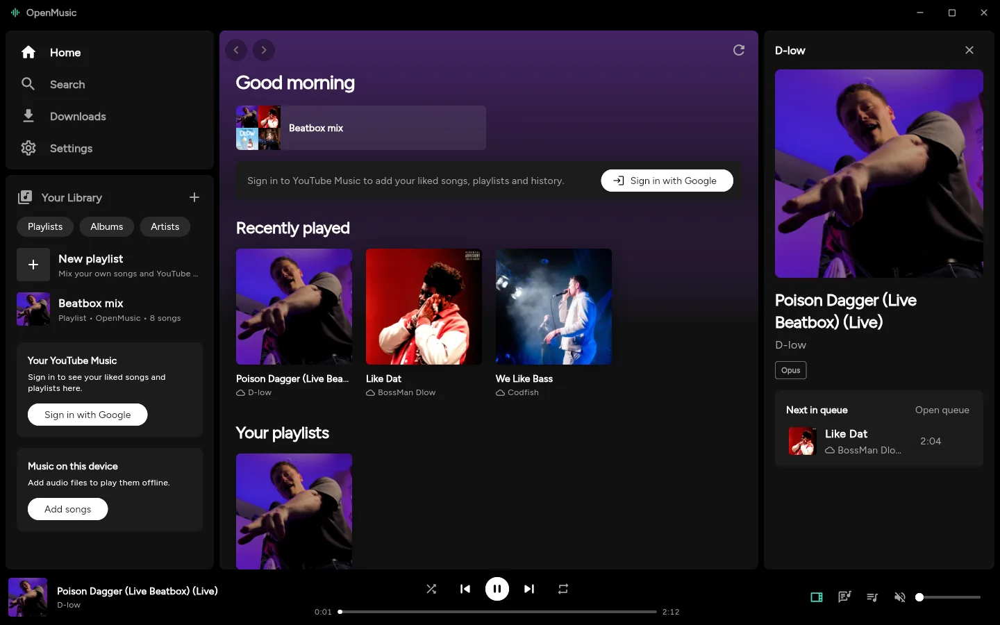
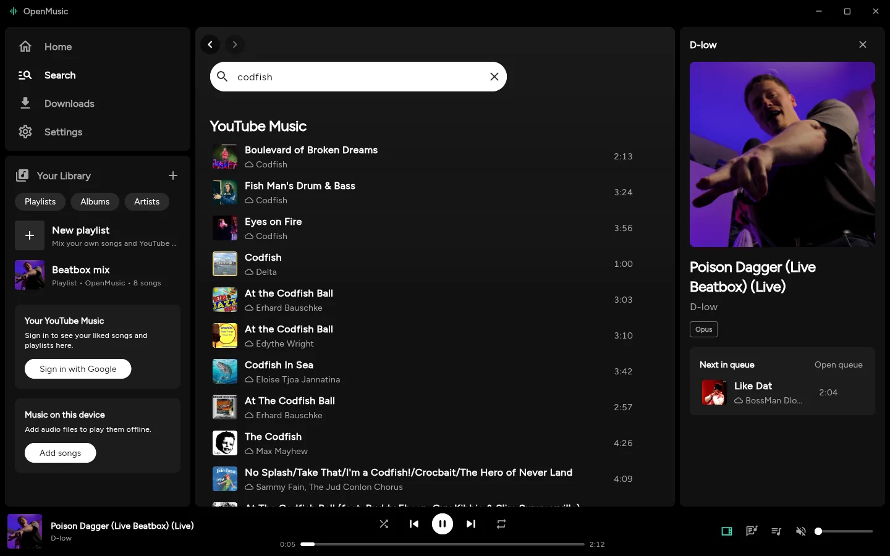
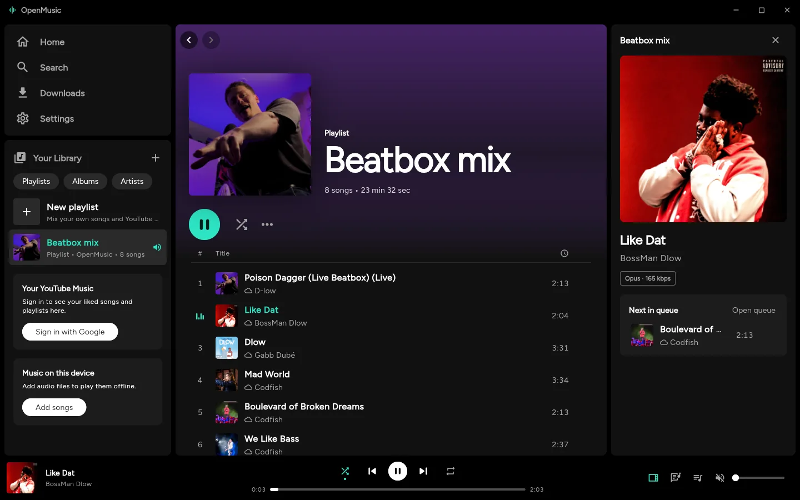
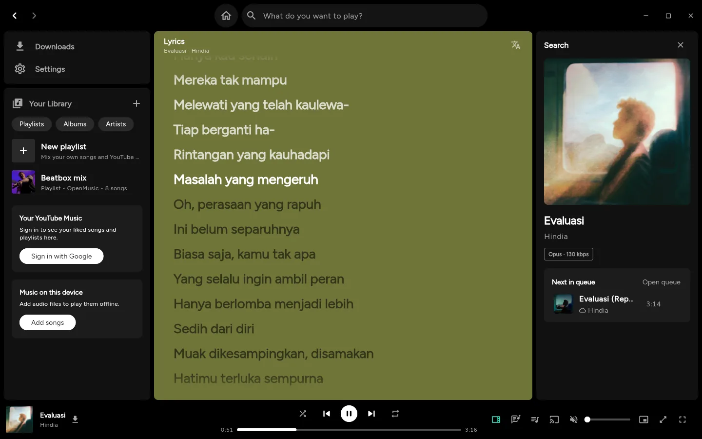
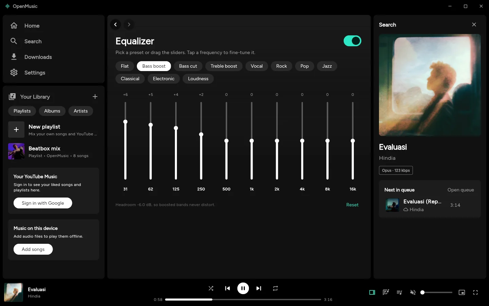
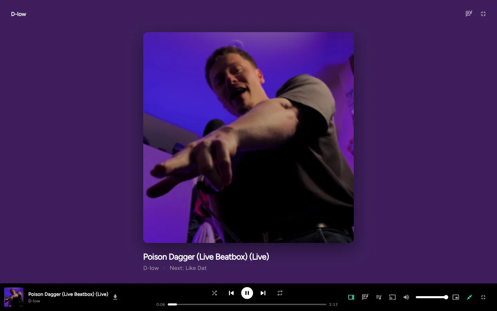
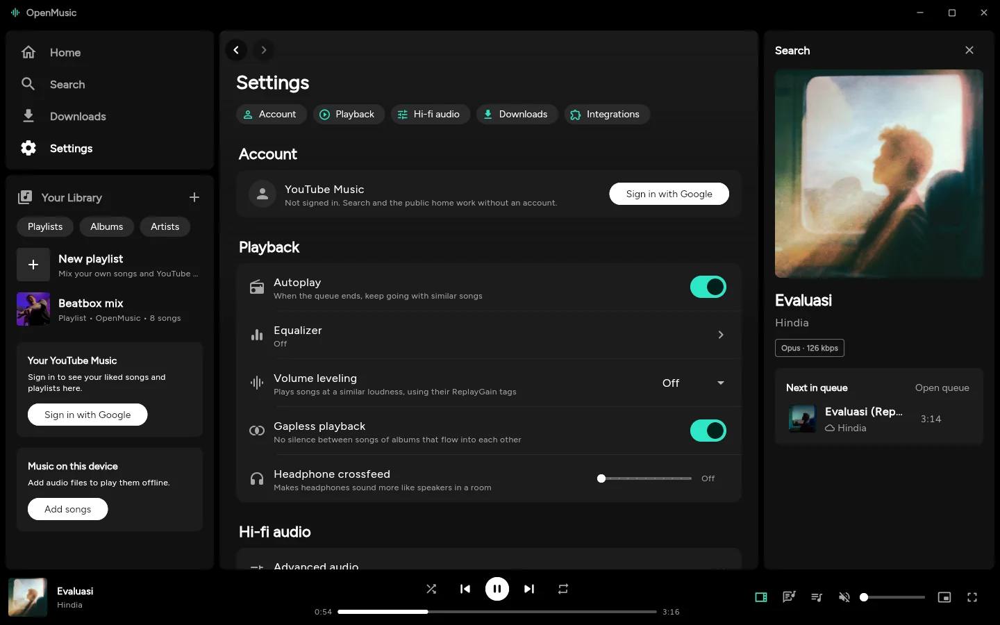
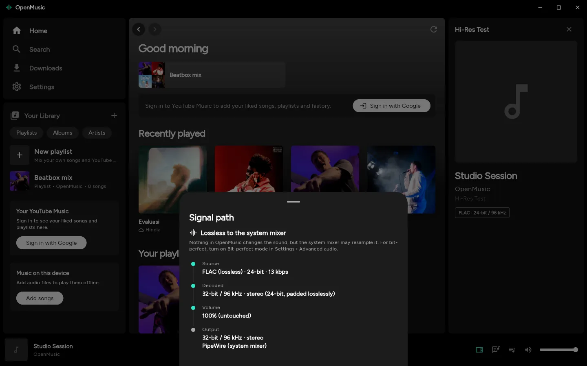
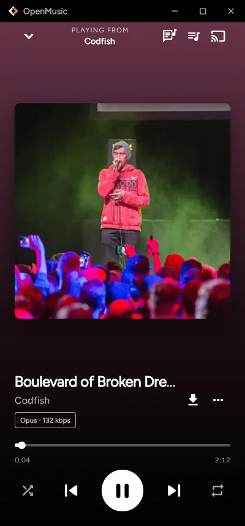

<div align="center">

<picture>
  <source media="(prefers-color-scheme: dark)" srcset="assets/icon/openmusic-transparent.svg">
  
</picture>

# OpenMusic

**Your own music and YouTube Music in one player, with hi-fi audio.**

A free, open-source music player for Linux, Windows, macOS, Android and iOS, built with Flutter.

[](LICENSE)
[](https://flutter.dev)

[](CONTRIBUTING.md)



</div>

## Table of contents

- [Features](#features)
- [Screenshots](#screenshots)
- [Build from source](#build-from-source)
- [YouTube Music](#youtube-music)
- [Audio](#audio)
- [Platform notes](#platform-notes)
- [Contributing](#contributing)
- [Acknowledgements](#acknowledgements)
- [License](#license)

## Features

| Feature | What you get |
|---|---|
| **One library** | Files on your device, your playlists and YouTube Music show up together in Home, Search and Library. YouTube Music songs carry a small cloud (they stream). Everything else plays offline, including YouTube songs you've downloaded. |
| **Your music** | Reads tags and cover art from FLAC, ALAC, WAV, AIFF, MP3, AAC, Ogg, Opus, WavPack, APE, DSD (DSF/DFF) and more, and plays **SACD ISO images** straight from the image (DST discs too). Groups albums and artists, splits cue sheets and shows multi-disc albums. Includes a tag editor (FLAC, MP4 / M4A, MP3, Ogg...) that keeps ReplayGain and custom tags. |
| **YouTube Music, no account needed** | Home, charts, search and radio work signed out. Press **Sign in with Google** to add your liked songs, playlists and history. You can like songs and create, rename and delete playlists, and add or remove their songs, right from the app. |
| **Search from anywhere** | On desktop the search box sits in the title bar, next to Home, on every screen: results appear as you type, split into Songs, Artists, Albums and Playlists with a top result first, and recent searches come back when it's empty. On phones it has its own tab, with suggestions and direct hits under the box. |
| **Follow artists** | Artists you follow on YouTube Music show up in your library; follow or unfollow from any artist page. |
| **Playlists** | OpenMusic playlists live on your device and can mix your own files with YouTube Music songs. |
| **Autoplay** | When the queue ends, similar songs keep coming from YouTube Music's own *Up next* radio. You can also *Start radio* from any song. |
| **Synced lyrics** | Follow the song line by line, from YouTube Music's own lyrics, a `.lrc` file, the file's tags, [LRCLIB](https://lrclib.net), [Better Lyrics](https://betterlyrics.org), NetEase Cloud Music or [lyrics.ovh](https://lyrics.ovh). Click a line to jump to it. Turn on **Pronunciation** (romaji for Japanese, and the like for other scripts) and **Translation** into your language under each line. |
| **Hi-fi audio** | On desktop and Android: a 10-band parametric equalizer, ReplayGain, gapless playback, headphone crossfeed and bit-perfect output, plus **native DSD to your DAC (DoP)** and **audio plugins** (VST, LV2, CLAP through Carla) on Linux. A live **signal path** shows exactly what happens to every sample. See [Audio](#audio). |
| **Play on TVs and speakers** | **Play on** sends the music to a TV, speaker or receiver on your network, DLNA / UPnP or AirPlay, from where it was; play, pause, seek, the queue and volume keep working from the app. |
| **Fast** | YouTube songs start in about 0.3 s and the next one in the queue in under 20 ms (it's fetched ahead); Home appears at once on launch from the last session's shelves. Light on memory too: about 165 MB at rest on Linux. |
| **Make it yours** | Whole colour schemes, not just an accent: Default, Monochrome, Catppuccin (Mocha, Macchiato, Frappé, Latte), Everblush, Everforest (dark and light), Nord, Gruvbox, Tokyo Night, Dracula and Rosé Pine. Pick an accent on top, any font installed on your device (or dropped into the app's `fonts` folder; Figtree is OpenMusic's own), the text size in pixels, tint the app with the cover art or keep it neutral, choose a blurred-cover or plain Now Playing background, turn on frosted-glass bars, and on Linux make the window see-through so your compositor's blur shows behind it. |
| **Downloads** | Save any YouTube song or playlist for offline listening, byte for byte in the best quality YouTube serves. |
| **Made for every screen** | Bottom tabs and a floating mini player on phones (swipe it to change song), a library sidebar and now-playing panel on desktop, tested from 240×320 up to 4K. Desktop navigation works like a browser: Back and Forward in the title bar, mouse side buttons, `Alt+←/→`. The window opens centred, sized to your screen. |
| **Expanded, full-screen and mini player** | On desktop, like Spotify's: the cover fills the window (**Expanded player**) or the whole screen (`F11`, `Esc`), with the synced lyrics beside it at the press of **Lyrics**; or the window shrinks to a small always-on-top player. |
| **System media controls** | The Android notification and lock screen, Control Center on iOS / macOS, and MPRIS on Linux (desktop media widgets, `playerctl`). |
| **Discord, media keys, shortcuts** | Discord Rich Presence, media keys and keyboard shortcuts (`Space`, `Ctrl+K`, `Ctrl+←/→`, `Ctrl+↑/↓` for volume, `Ctrl+V` to import a copied YouTube link). |

## Screenshots

| Search: your music and YouTube Music | A playlist mixing artists |
|---|---|
|  |  |
| **Synced lyrics** | **Equalizer** |
|  |  |
| **Full-screen player** | **Settings** |
|  |  |
| **Signal path** | **On a phone** |
|  |  |

## Build from source

You need the [Flutter SDK](https://docs.flutter.dev/get-started/install) (stable channel), plus the usual desktop toolchain (Linux: `clang`, `cmake`, `ninja`, `pkg-config`, GTK 3 and `libmpv` headers).

```sh
git clone https://github.com/Araryarch67/OpenMusic.git
cd OpenMusic
flutter pub get
flutter run -d linux          # or: windows, macos, android, ios
flutter build linux --release # build/linux/x64/release/bundle/
```

After pulling changes that add packages, quit and run `flutter run` again; hot reload doesn't load new plugins.

## YouTube Music

Everything public works without an account. **Sign in with Google** opens Google's own sign-in page, in its own window on Linux and inside the app elsewhere. Once it lands on YouTube Music, the session is kept in the app's private storage on your device. OpenMusic never sees your password, and nothing is sent anywhere except to YouTube Music itself.

Changes you make (likes, playlists) go through YouTube Music's own API, so they show up in the official apps too.

## Audio

On Linux and Windows, playback runs on [libmpv](https://mpv.io). OpenMusic drives it directly:

| | |
|---|---|
| **Sound** (Settings) | Equalizer with presets and automatic headroom, volume leveling (ReplayGain per song or album), gapless playback, headphone crossfeed |
| **Advanced audio** | Output device, including direct ALSA hardware devices; **bit-perfect mode** (no DSP, no resampling, volume fixed at 100%; WASAPI exclusive on Windows, not yet tested on real hardware); **Native DSD (DoP)**: DSF, DSDIFF and SACD songs go to a DoP-capable DAC as DSD (with bit-perfect mode); **audio plugins**: VST2, LV2, CLAP and LADSPA plugins set up in [Carla](https://kx.studio/Applications:Carla), in the chain after the equalizer (Linux, with Carla installed; VST3 not yet); **ASIO output** on Windows, built into the app's own libmpv (tested under Wine, not yet on real hardware); output sample rate; SoX resampler; buffer size |
| **Play on** | DLNA / UPnP renderers and classic AirPlay speakers, found on the network. Files the device can't play (DSD, cue-sheet songs, WavPack...) are converted to FLAC on the fly, YouTube songs go as AAC; AirPlay gets ALAC. Never tried on real TVs or speakers yet: tested against a simulated renderer and shairport-sync |
| **Signal path** | Source codec and stored bit depth → decoder → every DSP stage → volume → resampler → output device, with a verdict: *Bit-perfect*, *Lossless to the system mixer* or *Processed* |

What works, what is partial and how it was tested, item by item, is in **[Features.md](Features.md)**.

## Platform notes

| Platform | Playback | YouTube streaming / downloads |
|---|---|---|
| Linux | libmpv | YouTube's player API; yt-dlp as a fallback (system one, or the official binary downloaded automatically) |
| Windows | libmpv (bundled) | YouTube's player API; yt-dlp as a fallback (downloaded automatically) |
| macOS | AVPlayer | yt-dlp, AAC only (AVPlayer can't play Opus/WebM) |
| Android | libmpv (bundled) | YouTube's player API, built-in extractor as a fallback |
| iOS | AVPlayer | YouTube's player API, built-in extractor as a fallback |

The equalizer, leveling and signal path need libmpv (Linux, Windows, Android); crossfeed, room correction and the output device choice are Linux and Windows only. yt-dlp needs a JavaScript runtime (Deno or Node) for some YouTube challenges.

Nothing else needs installing. The tag editor for MP3 / Ogg / WAV…, AirPlay, and casting formats a TV can't play use FFmpeg: a system one when there is one, otherwise the official static build (gyan.dev on Windows, johnvansickle.com on Linux, about 40 MB) is downloaded the first time one of them is used, checked against its published checksum and kept in the app's folder.

Debug builds append every Flutter error with its full stack trace to `<app support dir>/errors.log` (on Linux, `~/.local/share/dev.openmusic.openmusic/errors.log`).

## Contributing

Bug reports, ideas and pull requests are welcome. Start with **[CONTRIBUTING.md](CONTRIBUTING.md)**. **[AGENT.md](AGENT.md)** explains how the code is laid out and how to test it (it's written for coding agents, but people find it useful too).

## Acknowledgements

OpenMusic stands on the shoulders of:

- [mpv](https://mpv.io) / [media_kit](https://github.com/media-kit/media-kit) and [just_audio](https://github.com/ryanheise/just_audio) for playback
- [FFmpeg](https://ffmpeg.org) for decoding, filters and resampling (with [SoX's resampler](https://sourceforge.net/projects/soxr/))
- [yt-dlp](https://github.com/yt-dlp/yt-dlp) and [youtube_explode_dart](https://github.com/Hexer10/youtube_explode_dart) for YouTube audio
- [ytmusicapi](https://github.com/sigma67/ytmusicapi), whose documentation of YouTube Music's API this app follows
- [LRCLIB](https://lrclib.net), [Better Lyrics](https://betterlyrics.org), NetEase Cloud Music and [lyrics.ovh](https://lyrics.ovh) for free lyrics
- [audio_metadata_reader](https://github.com/ClementBeal/audio_metadata_reader) for tags

OpenMusic is not affiliated with YouTube, Google or Discord.

## License

OpenMusic is free software: you can redistribute it and/or modify it under the terms of the **GNU Affero General Public License v3.0** as published by the Free Software Foundation. See [LICENSE](LICENSE).

If you run a modified version for others over a network, the AGPL asks you to offer them its source too.

Vendored packages in [`third_party/`](third_party) keep their own licenses (the Unlicense for `just_audio_media_kit`, MIT for `audio_metadata_reader`, GPLv3 for Steinberg's `asiosdk`).
